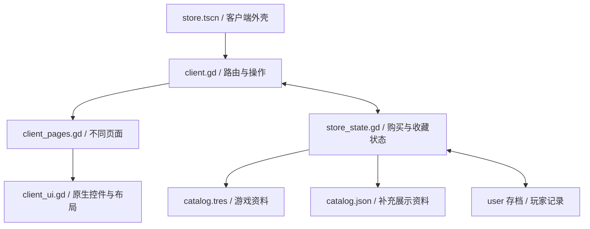

# 游戏回忆录 v0.3 · 客户端结构

## 场景与页面

主入口为 `scenes/store.tscn`，根节点 MemoirClient 挂载 `client.gd`。

| 固定节点 | 类型 | 作用 |
|---|---|---|
| MemoirClient | Control | 整个客户端根节点 |
| Background | ColorRect | 纵向蓝灰渐变背景 |
| Layout | VBoxContainer | 按头部、商店导航、正文、底栏排列 |
| ClientHeader | PanelContainer | 菜单、前后退、一级导航和钱包 |
| StoreNavigation | PanelContainer | 商店下拉导航、搜索、愿望单和购物车 |
| ContentScroll | ScrollContainer | 商店等页面的主滚动区域；库使用独立的内部滚动区 |
| PageContent | VBoxContainer | 当前页面根容器，切换页面时替换内容 |
| StatusBar | PanelContainer | 添加游戏、下载状态、年月、好友 |
| Notification | PanelContainer | 不打断浏览的右下角提示 |
| Notification/Message | Label | 提示文字 |

所有页面都是原生 Godot 节点。运行时切换到 Remote 可查看页面内部的 Container、按钮、封面和文本。

## 四个脚本的分工

`client.gd` 负责当前页面、浏览历史、外壳菜单和用户操作。`client_pages.gd` 读取状态，为每类页面构建独立布局。`client_ui.gd` 提供按钮、图片、容器、卡片等通用外观。`store_state.gd` 处理资源读取、界面兼容数据、交易规则与玩家状态。

## 页面切换

`navigate({"kind":"product","id":"distant_signal"})` 会记录当前浏览位置、维护前进后退历史，并构建商品页。`go_history()` 恢复过去的路由。页内按钮更新后会按需保留滚动位置。

容器布局需要经过帧更新，`_restore_scroll()` 会等待布局完成，并使用 render_serial 防止旧页面延迟回调覆盖新页面位置。

`route.kind` 支持 home、search、product、queue、wishlist、cart、checkout、receipt、library、downloads、profile、community。

## 游戏库

游戏库使用左侧列表与右侧独立滚动内容。LibraryContentScroll 是右侧区域。左侧可筛选全部、已安装和收藏夹；点击游戏切换其封面、安装/开始按钮和动态。右键条目打开原生 PopupMenu。

## 下载与游玩

下载 Timer 每 0.35 秒推进队首任务 8 点进度。达到 100 后将 ID 加入 installed，移出 downloads 并更新显示。这个计时仅模拟游戏世界中的安装，不传输网络文件。

开始游戏打开原生 AcceptDialog 内的游玩展示。确认结束后 `record_play()` 增加 45 分钟与一次记录。running_game_id 在结算前清空，防止重复计入。

## 购买与存档

cart 仍是 ID 列表，checkout() 验证全部商品和预算后一次性扣款，更新 owned/history，移除对应愿望单项，再保存。安装、收藏夹、关注和忽略不会改变商品所有权。

版本 2 存档扩展 installed、favorites、ignored、followed、play_minutes、play_sessions、downloads、activity，仍能读取版本 1 存档。

## Excel 与资源

`tools/catalog/game_catalog.xlsx` 是基础游戏资料来源。Python 导入器生成 `generated/game_catalog/games/*.tres` 与总清单 `catalog.tres`。模板放在带 `.gdignore` 的工具目录，运行时只注册生成目录中的 GameDefinition 和 GameCatalog。

`store_state.gd` preload 总清单，按资源顺序构建现有页面使用的 Dictionary。13 个表格字段覆盖对应旧值；原 JSON 只为相同 ID 补充评价、标签、英文名和现有折扣等资料，无法把资源清单中不存在的游戏重新加入商店。仅新增到 Excel 的游戏可直接显示，缺少的补充数据使用默认值。

`definition(id)` 返回原始 GameDefinition，`release_state(id)` 查询 hidden/coming_soon/available/delisted。界面封面使用 `capsule`，商品页使用 `cpu`、`gpu`。类型筛选支持 genres 中的多个类型。

存档继续记录从 2003 年 9 月开始的相对 month_index；`current_ym()` 在查询资源时转换为 YYYYMM，旧存档无需改变月份格式。上架和下架使用资源月份，已购下架游戏继续出现在库中。

生成器保留 Godot 创建的脚本 `.gd.uid`，避免每次导入改变脚本身份。`--check` 只检查 Excel、模板与生成结果是否一致，不写文件。

## 后续修改建议

新增页面改 client_pages.gd 并在 render_page() 加入路由；新增经营规则放到 store_state.gd；改变全局外观优先修改 client_ui.gd 与 client_theme.tres。新增游戏先编辑 Excel 并运行导入器，保持稳定 ID，避免旧存档丢失关联。后续折扣排期和评价变化可在独立数据中扩展。
