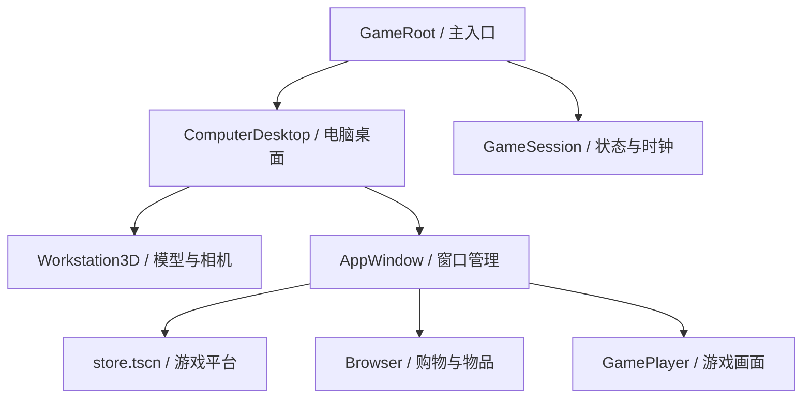

# 游戏回忆录 v0.4 · 场景与运行机制

## 主场景与共享数据

`scenes/main/game_root.tscn` 是唯一主入口。GameRoot 只持有 GameSession 和 ComputerDesktop；启动后直接显示 3D 设备工作台，活动由持续存在的 GameSession 推进。

GameSession 持有唯一 `MemoirStoreState` 实例。平台通过 `session` 与 `state` 注入接入，网页和游戏画面直接读同一实例。钱包、收藏和生活数据各只有一份。嵌入平台不重复加载存档，也不启动自己的下载 Timer。

## 场景与脚本

| 场景 | 脚本职责 |
|---|---|
| `main/game_root.tscn` | `game_root.gd`：注入共享会话、启动电脑桌面、连接游玩请求和屏幕通知 |
| `computer/computer_desktop.tscn` | `computer_desktop.gd`：Node3D 根场景，主视口直接旋转 / 缩放、检视 / 屏幕状态、射线输入映射、任务栏和应用管理 |
| `computer/ui/app_window.tscn` | `app_window.gd`：窗口标题栏、拖动、铺满、关闭和最小化信号，挂载应用内容 |
| `apps/platform/store.tscn` | `client.gd`：平台路由与操作；`client_pages.gd` 绑定页面场景；`client_ui.gd` 提供图片资源工具 |
| `apps/browser/browser.tscn` | `browser.gd`：购物、库存与安装界面，交易交给会话执行 |
| `apps/game/game_player.tscn` | `game_player.gd`：四图轮播、活动状态、成就进度和直播操作 |

ComputerDesktop 是原生 Node3D 场景，Workstation3D 直接渲染到主视口，HUD 单独放在 CanvasLayer。总览拖动旋转与滚轮缩放直接操作相机；仅短距离单击才拾取设备或进入屏幕。切换模式保留总览视角，“重置视角”恢复编辑器默认镜头。

屏幕输入由相机射线映射到实时纹理的 UV，再送入 DesktopViewport。嵌入的独占弹窗通过宿主 Window 输入桥接，保留原生按钮、Esc 与菜单处理，并防止关闭时点击穿透。

生活脚本位于 `scripts/life/`。`life_data.gd` 定义商品、初始生活数据、能力权重、通用成就模板和存档数据清理规则。替换正式美术时，可先修改电脑近景 / 图片显示，不必修改交易或存档逻辑。

## 操作如何传递

- 平台购买 → 共享 State 扣款和增加所有权 → `changed` 通知其他界面。
- 平台启动游戏 → GameSession 校验购买、安装和活动占用 → `play_requested` → 桌面打开游戏窗口。
- 网页购买 / 安装 → GameSession 校验预算、库存和物品位置 → 修改共享状态 → 库存与设备加成更新。
- 游玩解锁成就 → State 保存记录 → 屏幕提示通知与成就记录更新。

`changed` 用于交易、装备、成就和活动变化；`tick_updated` 用于每个模拟分钟的文字与进度更新。跨场景操作使用信号或会话方法，网页只通过共享会话执行交易。

## 玩家工作台布局

ComputerDesktop 的布置模式与屏幕操作互斥。TableGroup 承载桌子和设备，单独调整设备时保存桌面相对坐标；InspectionStage 临时展示检视中的设备，退出恢复最后确认布局。草稿只在内存中变化，只有有效布置被应用后，才写入 life.workstation_layout 并更新检视恢复位置。取消或编辑中退出不覆盖确认布局。旧版本 3 存档缺少此字段时使用场景默认值，详见 docs/WORKSTATION_LAYOUT.md。

## 活动与窗口寿命

GameSession 的 1 秒 Timer 统一推进 1 分钟模拟活动，并处理下载。`life.active` 同时只允许一项主要活动：play 或 guide。直播是 play 的附加状态；制作攻略与游玩互斥。

工作台总览、单品检视与屏幕操作之间只改变相机和展示状态，不销毁桌面视口。最小化、返回设备展示、关闭平台不会停止活动。关闭游戏窗口或点击结束游玩才调用 `stop_play()`，结束直播并只记录一次会话。重复关闭不重复增加游玩时间。进度在每分钟累计，结束时不会额外增加旧版的 45 分钟。

活动随版本 3 存档保存。重新进入后，时钟继续推进；“继续游玩”打开运行窗口，显示已有进度。离线时间不结算。发行年月仍沿用商店的手动月份进度和每月 60 点预算补充。

## 玩家属性、成就与收入

初始六项能力均为 10。能力权重由游戏 genres 选择，多人 / 合作使协作占 20%，其余能力权重按比例缩小。挑战倍率为 `(1 + 加权能力 / 100) × 主机倍率 × 外设倍率`。游玩增加对应能力，每项最多 100。

每款游戏初版共用 10、60、180 点三个里程碑。直播每 5 分钟结算一次，基础 2 点，主机 / 麦克风可增加收入。攻略需至少游玩 10 分钟，制作耗时 20 分钟；每款只可发布一次，成就数量影响稿费，后续每 10 分钟 1 点阅读收益，最多 60 次。

每种设备同时安装一件拥有的物品。3D 设备源场景位于 scenes/computer/hardware/，工作台相机、灯光和位置可直接在 computer_desktop.tscn 的 Workstation3D 子树编辑，复用源场景为 workstation_3d.tscn；模型来自 assets/models/hardware/*.glb，制作源文件与脚本在 tools/models/。显示器使用独立 monitor 槽位；旧存档自动补入 starter_monitor，原有设备与钱包保留。外观目录为 data/hardware/_catalog.tres，显示器、机箱、键盘和鼠标各有独立模型。房间相关场景、贴图和展示操作已删除；房间专属商品停售。历史家具、装备位置、布置和展示记录继续通过版本 3 存档读写，库存中仅作为收藏记录。设备属性、价格和收益均为首版演示平衡值。CPU/GPU 型号暂作展示文本，不据此阻止启动游戏。

## 平台页面与游戏数据

平台 `route.kind` 支持 home、search、product、queue、wishlist、cart、checkout、receipt、library、downloads、profile、community。community 作为兼容路由保留，显示“创作”页的直播和攻略内容。类型菜单直接来自当前资源目录。

平台保存浏览历史与滚动位置。窗口最小化时保留页面；关闭后重新打开回到首页，但所有权、钱包与活动仍来自共享状态。单独运行 `apps/platform/store.tscn` 是开发预览模式，保留原客户端模拟窗口与独立下载计时，用于兼容检查。

游戏基础资料继续由 Excel 生成 `data/games/*.tres` 和 `_catalog.tres`。`game.gd` 是单款游戏唯一 Resource 定义，`game_catalog.gd` 提供目录查询。封面字段 capsule 与有序 screenshots 由导入器根据 game_id 自动生成，分别驱动商店和游戏轮播；Excel 不再填写素材路径。enabled 空白的草稿不会导出。导入器不生成脚本。

`data/catalog.json` 仍按 ID 补充旧示例的评价、英文名、演示折扣等；无法把资源目录不存在的游戏加入正式商店。CounterSquad 等没有补充条目的游戏使用默认展示资料。

## 存档与验证

路径仍为 `user://memoir_store_v01.json`，版本 3 在原有钱包、月份、收藏、安装与游玩记录之外新增 life：物品、装备、六项属性、进度、成就、展示内容、攻略、活动和收入。

读取兼容版本 1、2、3，旧存档获得默认生活资料。生活存档会校验物品 ID、装备位置和所有权，限制属性范围，移除无效活动与未获得的展示奖杯。保存仍先写临时文件再替换。

`tests/life/test_life_flow.gd` 覆盖桌面→购买→安装→游玩→直播→购物→安装设备→攻略→保存恢复的完整流程，并检查重复扣款、活动互斥、阅读收益上限和旧版迁移。

## 可视化场景编辑

固定界面、页面和电脑外观均保存为真实 `.tscn` 节点。编辑入口、模板位置及运行数据与预览的区别见 [EDITOR_WORKFLOW.md](EDITOR_WORKFLOW.md)。
