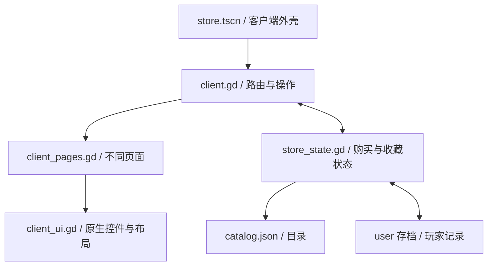

# 游戏回忆录 v0.3 · 客户端结构

## 场景与页面

主入口为 `scenes/store.tscn`，根节点 MemoirClient 挂载 `client.gd`。

| 固定节点 | 类型 | 作用 |
|---|---|---|
| MemoirClient | Control | 整个客户端根节点 |
| Background | ColorRect | 纵向蓝灰渐变背景 |
| Layout | VBoxContainer | 按头部、商店导航、正文、底栏排列 |
| ClientHeader | PanelContainer | 菜单、前后退、一级导航和钱包 |
| StoreNavigation | PanelContainer | 商店下拉导航、搜索、愿望单和购物车 |
| ContentScroll | ScrollContainer | 商店等页面的主滚动区域；库使用独立的内部滚动区 |
| PageContent | VBoxContainer | 当前页面根容器，切换页面时替换内容 |
| StatusBar | PanelContainer | 添加游戏、下载状态、年月、好友 |
| Notification | PanelContainer | 不打断浏览的右下角提示 |
| Notification/Message | Label | 提示文字 |

所有页面都是原生 Godot 节点。运行时切换到 Remote 可查看页面内部的 Container、按钮、封面和文本。

## 四个脚本的分工

`client.gd` 负责当前页面、浏览历史、外壳菜单和用户操作。`client_pages.gd` 读取状态，为每类页面构建独立布局。`client_ui.gd` 提供按钮、图片、容器、卡片等通用外观。`store_state.gd` 只处理数据与规则。

## 页面切换

`navigate({"kind":"product","id":"distant_signal"})` 会记录当前浏览位置、维护前进后退历史，并构建商品页。`go_history()` 恢复过去的路由。页内按钮更新后会按需保留滚动位置。

容器布局需要经过帧更新，`_restore_scroll()` 会等待布局完成，并使用 render_serial 防止旧页面延迟回调覆盖新页面位置。

`route.kind` 支持 home、search、product、queue、wishlist、cart、checkout、receipt、library、downloads、profile、community。

## 游戏库

游戏库使用左侧列表与右侧独立滚动内容。LibraryContentScroll 是右侧区域。左侧可筛选全部、已安装和收藏夹；点击游戏切换其封面、安装/开始按钮和动态。右键条目打开原生 PopupMenu。

## 下载与游玩

下载 Timer 每 0.35 秒推进队首任务 8 点进度。达到 100 后将 ID 加入 installed，移出 downloads 并更新显示。这个计时仅模拟游戏世界中的安装，不传输网络文件。

开始游戏打开原生 AcceptDialog 内的游玩展示。确认结束后 `record_play()` 增加 45 分钟与一次记录。running_game_id 在结算前清空，防止重复计入。

## 购买与存档

cart 仍是 ID 列表，checkout() 验证全部商品和预算后一次性扣款，更新 owned/history，移除对应愿望单项，再保存。安装、收藏夹、关注和忽略不会改变商品所有权。

版本 2 存档扩展 installed、favorites、ignored、followed、play_minutes、play_sessions、downloads、activity，仍能读取版本 1 存档。

## 后续修改建议

新增页面改 client_pages.gd 并在 render_page() 加入路由；新增经营规则放到 store_state.gd；改变全局外观优先修改 client_ui.gd 与 client_theme.tres。新增真实历史条目先整理 catalog.json，保持稳定 ID，避免旧存档丢失关联。
