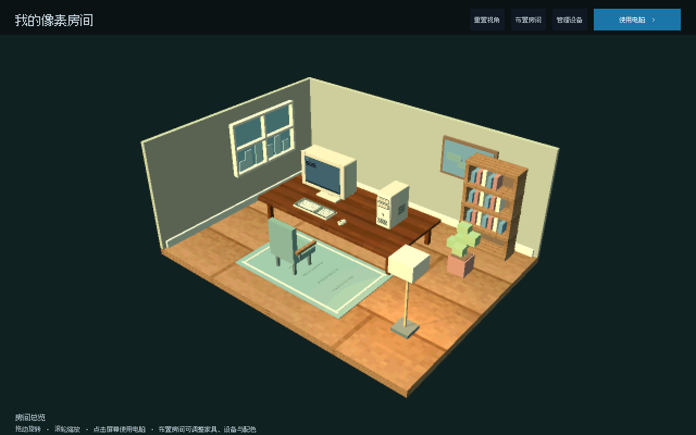
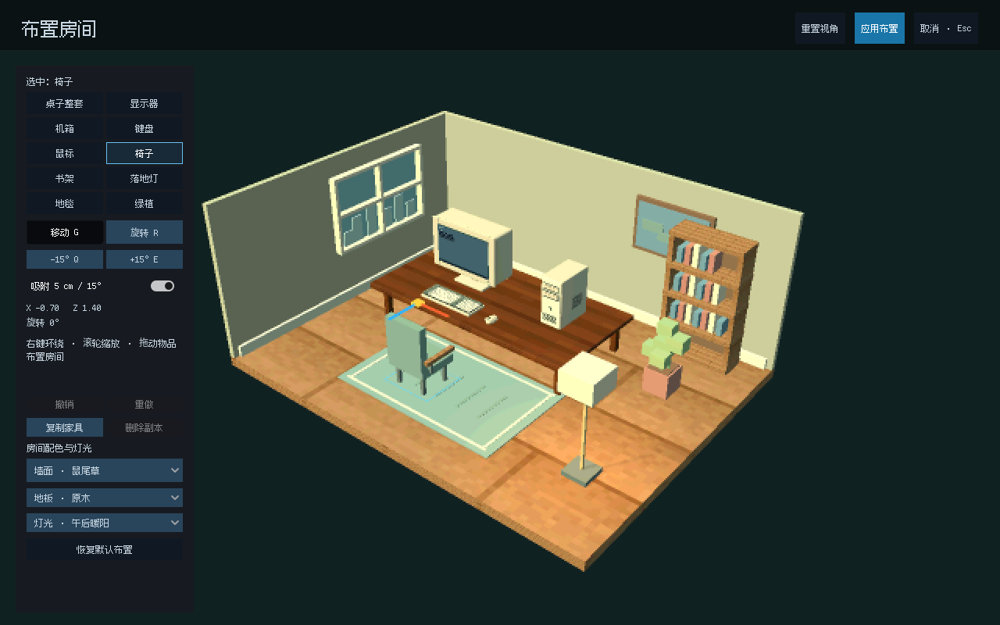

# 游戏回忆录 · 像素 3D 房间 v0.5

Godot 4.6 像素 3D 房间布置与游戏收藏经营原型。玩家从自己的房间开始，通过电脑中的游戏平台购买、安装和游玩作品，也可以直播、制作攻略赚取游戏内点数，再通过购物网页升级电脑设备。

## 打开与运行

1. 使用 Godot 4.6 导入仓库根目录的 project.godot。
2. 等待首次资源导入完成，按 F5 运行。主场景为 scenes/main/game_root.tscn。
3. 房间总览支持左键或右键拖动环绕、滚轮缩放，以及“重置视角”。
4. 点击显示器屏幕或“使用电脑”，进入电脑界面；Esc 或“返回房间”回到 3D 总览。

项目使用 GDScript 和 Compatibility 渲染器，不需要 .NET。完整生活系统应从主场景运行；单独运行 scenes/apps/platform/store.tscn 可预览游戏平台客户端。

## 核心玩法

- 在游戏平台购买作品，在“库”中安装后启动。
- 游玩会累计时间、六项玩家能力、挑战进度和成就。
- 直播每 5 分钟模拟时间结算一次收入；最小化窗口或返回房间不会中断活动。
- 游玩满 10 分钟后可以制作攻略；制作耗时 20 分钟，发布后获得稿费和有限的阅读收益。
- 购物网页提供显示器、主机、键鼠和麦克风；购买后在物品栏安装。
- 初始钱包为 160 点。桌面、游戏平台和购物网页共用同一个 GameSession 与玩家存档。

## 时间、窗口与活动

默认 1 秒现实时间等于 1 分钟模拟活动时间。GameSession 独立于窗口运行，统一推进下载、游玩、直播、攻略制作和阅读收益。发行月份使用原型的手动“下个月”按钮，当前时间范围为 2003 年 9 月至 2004 年 2 月。

| 操作 | 行为 |
|---|---|
| 点击显示器 / 使用电脑 | 镜头移动到屏幕前，桌面以 1280 × 800 渲染 |
| Esc / 返回房间 | 回到设备展示；应用实例和活动继续 |
| 最小化应用 | 隐藏窗口，可从任务栏恢复 |
| 关闭游戏平台 | 游戏和直播继续；重新打开保留所有权与进度 |
| 关闭游戏窗口 / 结束游玩 | 结束本次游玩和直播，只记录一次游玩记录 |
| 制作攻略 | 与游玩互斥；期间仍可购物或查看平台 |
| 退出程序 | 保存活动和进度；下次进入继续，离线时间不结算收益 |

## 像素 3D 房间与布置

房间固定为 8 × 6 米的两面墙空间，默认斜俯视镜头。观察到墙外侧时，对应墙体、窗和装饰会自动隐藏。房间使用完整 GLB 模型、最近邻纹理和 400 像素高的画面采样；HUD 与显示器内的操作界面保持清晰。

点击顶栏“布置房间”进入编辑模式，可选择桌子、显示器、机箱、键盘、鼠标、椅子、书架、落地灯、地毯和绿植。拖动物品或手柄移动，R 旋转，Q / E 每步旋转 15°，默认吸附为 5 cm / 15°。桌子移动时设备一起跟随；设备始终留在桌面，家具留在房间地面。

移动使用扫掠占地检测，旋转检查中间路径，避免快速拖动或转动穿过其他物件。地毯允许铺在家具下方。椅子、书架、灯、地毯和绿植可复制，每类最多 8 个副本；Ctrl + D 复制，Delete 删除选中的副本，初始家具不能删除。Ctrl + Z 撤销，Ctrl + Shift + Z / Ctrl + Y 重做。

墙面、地板和空间灯光各有三套预设。RGB 灯光另提供冰青、深蓝、紫罗兰、洋红、琥珀、薄荷和玫瑰七种颜色，亮度 0–100%，以及常亮、呼吸、彩虹循环三种灯效；亮度设为 0 时关闭 RGB 发光和辅助灯。空间预设控制主光、补光和落地灯，RGB 控制设备与桌底装饰灯光。应用布置会一起保存家具、设备、副本和六项房间外观设置；取消 / Esc 丢弃未确认的草稿。“恢复默认布置”只修改草稿，仍需应用才会保存。屏幕操作、更换设备型号和后台自动保存不会覆盖未确认的草稿。详见 docs/WORKSTATION_LAYOUT.md 与 docs/WORKSTATION_LIGHTING.md。

## 玩家能力与收入

当前代码实现六项能力：反应、操作、思考、探索、规划、协作。游戏类型决定能力权重，多人 / 合作标签会提高协作占比。游玩逐步提升相关能力；能力和已安装主机、外设共同影响挑战进度倍率。

每款游戏使用三个通用里程碑：10、60、180 点挑战进度。直播每 5 分钟基础获得 2 点，安装麦克风或进阶主机后增加收入。每款游戏可制作一篇攻略；已解锁成就影响稿费，发布后每 10 分钟获得 1 点阅读收益，最多 60 次。

显示器、机箱、键盘和鼠标是四个独立 3D 设备模型。安装设备会切换对应外观；精准键鼠套装同时更换键盘和鼠标。CPU / GPU 型号目前作为商品展示文本，不作为游戏启动门槛。

## 模型、美术与编辑入口

- 电脑设备模型：assets/models/hardware/，共 9 个 GLB。
- 房间外壳与家具模型：assets/models/room/，共 6 个 GLB。
- 电脑模型源文件与重建脚本：tools/models/hardware.blend、build_hardware.py。
- 房间模型生成脚本：tools/models/build_room.py，使用 Python 3 和 Pillow 离线生成。
- 3D 工作台编辑入口：scenes/computer/computer_desktop.tscn，展开 Workstation3D。
- 房间家具场景：scenes/room/；房间表现逻辑：scripts/room/。
- 设备目录与碰撞尺寸：data/hardware/。

游戏运行只加载已导出的 GLB，不需要 Blender，也不会在运行时生成模型几何。

## 游戏资料管理

在 tools/catalog/game_catalog.xlsx 编辑游戏基础资料。Windows 可双击项目根目录 import_games.bat；也可在仓库根目录运行：

    python tools/catalog/import_games.py --project .

导入需要 Python 3.10 或以上版本，无第三方依赖；游戏运行不需要 Python。当前工作簿启用 CounterSquad 和 CTA3，未启用的行保留为草稿。

| 字段 | 规则 |
|---|---|
| game_id | 稳定 ID，保留大小写，例如 CounterSquad |
| genres | 用 / 分隔，例如 射击/动作/多人 |
| announce_ym / store_release_ym / delist_ym | YYYYMM 整数，分别控制预告、上架和下架 |
| CPU / GPU | 型号文本，显示在商品页 |
| enabled | 1=导出；0 或空白=草稿 |

素材目录由 game_id 自动推导为 assets/art/&lt;game_id&gt;/，包含 &lt;game_id&gt;.png 封面和 &lt;game_id&gt;01.png 至 &lt;game_id&gt;04.png 四张展示图。导入器生成 data/games/&lt;game_id&gt;.tres、_catalog.tres、README 和校验清单，不生成或覆盖源脚本。详细规则见 tools/catalog/README.md。

data/catalog.json 按相同 ID 补充英文名、标签、评价、安装大小、版本说明和演示折扣。新增游戏没有补充资料时使用默认值。已发布游戏应保留 ID 并通过 delist_ym 下架；enabled=0 或空白会从生成目录移除。

检查表格与生成结果：

    python tools/catalog/import_games.py --project . --validate-only
    python tools/catalog/import_games.py --project . --check

## 目录职责

| 位置 | 用途 |
|---|---|
| scenes/main/ | 主入口，组合共享会话和电脑工作台 |
| scenes/computer/ | 电脑工作台、四类设备、系统桌面、窗口壳与布置手柄 |
| scenes/room/ | 房间外壳及椅子、书架、灯、地毯、绿植场景 |
| scenes/apps/ | 平台、购物网页和游玩界面 |
| scenes/shared/ | 跨应用共用组件 |
| scripts/life/ | GameSession、桌面、窗口、活动、设备与布置逻辑 |
| scripts/room/ | 房间外观、灯光和家具拾取逻辑 |
| scripts/ | 平台导航、页面、游戏数据与玩家状态 |
| data/games/ | Excel 导入生成的正式游戏目录 |
| data/hardware/ | 设备模型映射、尺寸和屏幕校准 |
| tests/fixtures/ | 固定测试样本，不加入正式商店 |
| tools/ | Excel 导入器、资源审计和模型制作工具 |
| docs/ | 场景结构、布置规则、检查报告与运行截图 |

## 存档与兼容

玩家存档位于 user://memoir_store_v01.json，当前格式版本为 3，兼容读取版本 1、2。旧版钱包、购买、愿望单、安装和游玩记录继续保留；历史家具、展示和布置字段继续参与存档校验，不会因为房间功能调整而丢失。没有生活数据的旧存档会获得默认生活资料。

## 验证

建议在提交前按顺序运行：

    python tools/project_audit.py
    python tools/catalog/import_games.py --project . --check
    python -m unittest discover -s tests -p "test_catalog_importer.py" -v
    python -m unittest discover -s tests -p "test_showcase_models.py" -v
    godot --headless --path . --editor --import

Godot Headless 回归：

    godot --headless --path . --script res://tests/test_catalog_resources.gd -- --fresh
    godot --headless --path . --script res://tests/test_catalog_integration.gd -- --fresh
    godot --headless --path . --script res://tests/test_client.gd -- --fresh
    godot --headless --path . --script res://tests/test_store.gd -- --fresh
    godot --headless --path . --script res://tests/test_editor_scenes.gd -- --fresh
    godot --headless --path . --script res://tests/life/test_life_flow.gd -- --fresh
    godot --headless --path . --script res://tests/life/test_workstation_view.gd -- --fresh
    godot --headless --path . --script res://tests/life/test_workstation_lighting.gd -- --fresh
    godot --headless --path . --script res://tests/life/test_workstation_layout.gd -- --fresh
    godot --headless --path . --script res://tests/life/test_workstation_collision.gd -- --fresh
    godot --headless --path . --script res://tests/life/test_pixel_room.gd -- --fresh
    godot --headless --path . --script res://tests/life/test_audit_regressions.gd -- --fresh

test_client_windows.gd 需要图形环境；Linux CI 使用 Xvfb 执行。--fresh 禁用正常玩家存档读写，测试使用独立数据。GitHub Actions 会在 push、Pull Request 和手动触发时执行检查，包括模型重建、全部 GLB 结构检查、生成文件同步检查、Godot Headless 回归和 Xvfb 图形测试。

素材来源与授权见 ASSET_CREDITS.md；编辑入口见 EDITOR_WORKFLOW.md；完整结构见 CLIENT_STRUCTURE.md；当前维护审计见 docs/PROJECT_AUDIT.md。
