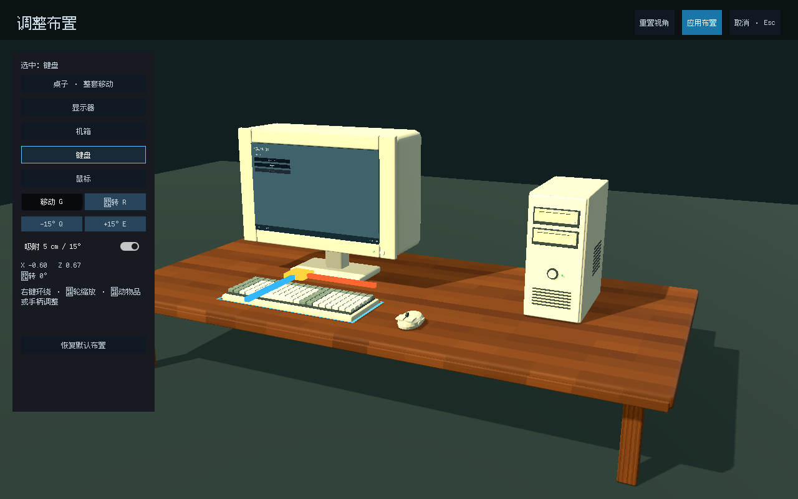

# 玩家调整工作台布置

在 ComputerDesktop 顶栏点击“调整布置”。单击物品或左侧列表选择桌子、机箱、显示器、键盘或鼠标；此时点击屏幕只会选中显示器，不操作系统应用。

| 操作 | 行为 |
|---|---|
| 移动 G | 拖动物品或黄色方块自由平移；红色手柄沿所选物品 X 轴，蓝色沿 Z 轴 |
| 旋转 R | 拖动黄色圆点水平旋转；Q / E 或角度按钮每次调整 15° |
| 吸附 | 默认按 5 cm / 15° 对齐，开关可关闭 |
| 右键拖动 / 滚轮 | 环绕观察 / 缩放，不改变物品布局 |
| 应用布置 | 有效时确认布局，写入现有存档，返回总览 |
| 取消 / Esc | 恢复进入编辑前最后确认的布局 |
| 恢复默认布置 | 将草稿恢复为编辑器保存的初始布局；仍需应用才保存 |

选择“桌子”会移动或旋转整套工作台。设备使用相对桌面的坐标，键盘与鼠标各自独立。设备底部始终贴合桌面，旋转后的完整底面也必须留在桌沿内。使用凸多边形分离轴检查设备占地重叠；冲突时选中框变红、显示冲突设备名称，并禁用应用。草稿可以暂时重叠，便于拖过其他物品后重新摆放。

## 场景与脚本

- `scenes/computer/workstation_3d.tscn`：TableGroup 下包含 Desk、DeskPickArea 和 Equipment。设备的底部原点、模型资源不变。
- InspectionStage：单件检视临时挂载设备，退出后重新挂回 Equipment，恢复玩家确认的位置和角度。
- `scenes/computer/ui/layout_gizmo.tscn`：已保存的选择框、平移与旋转手柄及其拾取区域；不动态生成家具模型。
- `scripts/life/workstation_layout.gd`：草稿、确认布局、手柄输入、吸附、边缘约束和占地碰撞检查。
- `scripts/life/workstation_layout_data.gd`：存档字段校验与凸多边形重叠判定。
- `computer_desktop.gd`：布置模式入口、HUD、输入分流和存档接入。

在 LayoutEditor 检查器中可调整桌面半尺寸、高度、边缘留白、桌子移动范围和吸附步长。默认桌面为 4.8×2.3 米，高 0.78 米，整套水平移动限制为中心两侧各 1.5 米。几何和这些限制应保持一致。

## 保存与兼容

继续使用版本 3 存档，在 `life.workstation_layout` 下保存 desk、monitor、computer、keyboard、mouse 的 `{x,z,yaw}`。desk 相对工作台场景，其余设备相对桌面组合。高度与缩放仍由场景控制，不写入玩家布局。

旧存档没有此字段时使用编辑器默认布置；读取只接受已知物品和有限数值，再按当前场景约束位置。不自动保存拖动草稿：取消、后台自动保存或在编辑中退出，都不会把未确认的草稿写入存档。装备切换保留设备位置；若更大型号导致占地不合适，可在布置模式调整。

正常运行会恢复玩家已保存的布置；`--fresh` 使用编辑器默认布置。总览、单件检视、屏幕操作不会重置已确认布局，商城、网页和运行中的应用继续共用原来的 GameSession。

## 验证

`tests/life/test_workstation_layout.gd` 覆盖真实输入拖动、轴向移动、旋转手柄、吸附开关、桌沿、重叠拦截、整套跟随、应用/取消、恢复默认、状态刷新、装备切换、检视往返、屏幕取景、保存读回和编辑中退出。

```bash
godot --headless --path . --script res://tests/life/test_workstation_layout.gd -- --fresh
```


